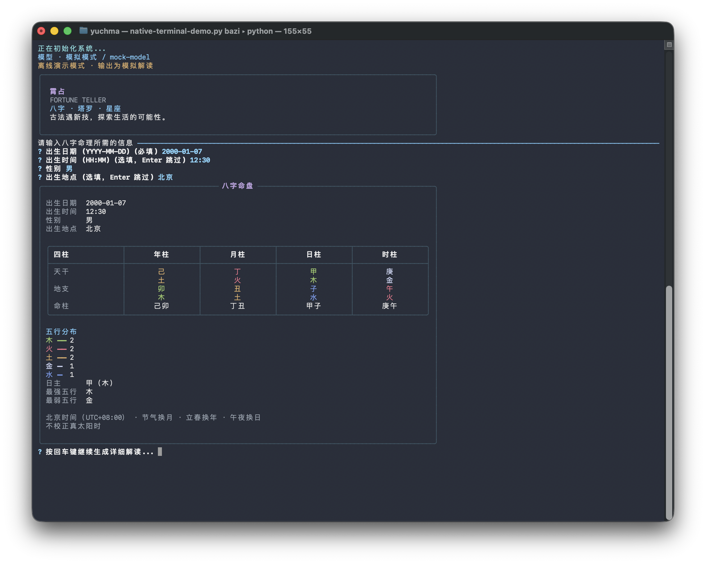
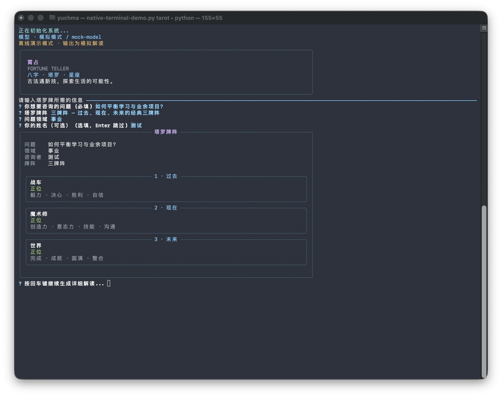
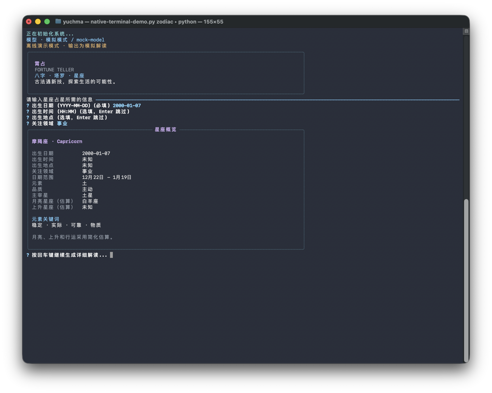

# 霄占 (Fortune Teller)

```
██╗  ██╗██╗ █████╗  ██████╗      ███████╗██╗  ██╗ █████╗ ███╗   ██╗
╚██╗██╔╝██║██╔══██╗██╔═══██╗     ╚══███╔╝██║  ██║██╔══██╗████╗  ██║
 ╚███╔╝ ██║███████║██║   ██║       ███╔╝ ███████║███████║██╔██╗ ██║
 ██╔██╗ ██║██╔══██║██║   ██║      ███╔╝  ██╔══██║██╔══██║██║╚██╗██║
██╔╝ ██╗██║██║  ██║╚██████╔╝     ███████╗██║  ██║██║  ██║██║ ╚████║
╚═╝  ╚═╝╚═╝╚═╝  ╚═╝ ╚═════╝      ╚══════╝╚═╝  ╚═╝╚═╝  ╚═╝╚═╝  ╚═══╝
```

> ✨ Ancient Wisdom at Your Fingertips / 古今命理，尽在掌握 ✨

**English | [中文](README.zh.md)**

A terminal fortune telling app that combines classical divination systems with modern LLMs. Rich charts and streamed Markdown, Questionary menus, and a bilingual UI.

## Terminal screenshots

These are actual macOS Terminal screenshots of the CLI, using sample inputs in offline mock mode. Each screen is paused before the LLM reading starts; tarot cards are randomly drawn and will vary between runs.

### BaZi: four pillars and five elements

Enter a birth date, optional time, gender and birthplace. The chart shows the year, month, day and hour pillars, color-coded elements and their distribution. Times use China Standard Time; birthplace does not change the timezone.



### Tarot: a question and a card spread

Enter a question, choose a spread and a topic, then review the drawn cards. Each panel shows its position, upright/reversed orientation and keywords. This example uses the past–present–future three-card spread.



### Zodiac: a concise sign overview

Enter a birth date and a topic to see the sun sign, element, modality and ruling planet. Moon, rising and transit information uses simplified estimates; this is not a full astronomical birth chart.



Press Enter after the chart to generate a reading, then continue with follow-up questions. Rich formats the streamed Markdown; Questionary handles menus and validated input.

## 🌟 Features

- **🀄 BaZi (八字命理)** — Traditional Chinese four-pillars reading driven by birth date/time
- **🃏 Tarot** — Card draws with several spreads and interpretation
- **⭐ Western Astrology** — Sun-sign analysis by birth date
- **💬 Follow-up chat** — Ask deeper questions after the main reading (career, relationships, health, timing…)
- **🌍 Bilingual** — English / 中文, selectable at launch or via `--lang`
- **⌨️ Arrow-key menus** — Falls back to numeric prompt when stdin isn't a TTY
- **⚡ Real streaming** — Tokens stream directly from the LLM; a spinner covers first-token latency
- **🔌 Multi-provider LLM** — AWS Bedrock (Claude), Anthropic direct, OpenAI, DeepSeek

## 🚀 Quick Start

```bash
# 1. Clone
git clone https://github.com/YuchengMaUTK/fortune-teller.git
cd fortune-teller

# 2. Install dependencies
python -m venv .venv && source .venv/bin/activate
pip install '.[bedrock]'  # or openai / deepseek / anthropic / all

# 3. Configure
cp config.yaml.example config.yaml
# Edit config.yaml — pick a provider, plug in credentials. See below.

# 4. Run
python -m fortune_teller
```

**Useful flags:**

```bash
python -m fortune_teller --lang en        # skip the language picker
python -m fortune_teller --system bazi    # skip the system picker
python -m fortune_teller --list           # list available systems
python -m fortune_teller --verbose        # enable console logging
```

## 🔧 Configuration

All configuration lives in `config.yaml`. The example file documents every provider; pick **one** `llm:` block.

### AWS Bedrock (recommended)

```yaml
llm:
  provider: aws_bedrock
  model: us.anthropic.claude-sonnet-4-5-20250929-v1:0
  region: us-west-2
  temperature: 0.7
  max_tokens: 6000
  # profile: my-profile    # optional named ~/.aws profile
```

Credentials are resolved by the **boto3 default chain**:

1. Explicit `aws_access_key` / `aws_secret_key` in `config.yaml`
2. `profile:` field pointing at a named AWS profile
3. Environment variables (`AWS_ACCESS_KEY_ID`, `AWS_PROFILE`, …)
4. `~/.aws/credentials` default profile, SSO, IMDS, `credential_process`, …

If `aws sts get-caller-identity` works in your shell, the connector will work too.

### Anthropic direct

```yaml
llm:
  provider: anthropic
  model: claude-sonnet-4-5-20250929
```

Reads the key from `ANTHROPIC_API_KEY`.

### OpenAI

```yaml
llm:
  provider: openai
  model: gpt-4o-mini
```

Reads the key from `OPENAI_API_KEY`.

### DeepSeek

```yaml
llm:
  provider: deepseek
  model: deepseek-chat
```

Reads the key from `DEEPSEEK_API_KEY`.

## 🎮 Usage

1. Pick a language (arrow keys / `q` to quit)
2. Pick a fortune system
3. Fill in the prompted information — birth date/time, question, spread
4. Watch the reading stream in
5. After the main reading, pick a follow-up topic for a deeper analysis, or chat freely with 霄占

## 🏗️ Architecture

```
fortune_teller/
├── main.py              # CLI entry point, interactive menu, follow-up, chat
├── core/
│   ├── llm_connector.py # Unified LLM dispatch (Bedrock/Anthropic/OpenAI/DeepSeek)
│   ├── aws_connector.py # Bedrock streaming + non-streaming
│   ├── config_manager.py
│   ├── plugin_manager.py
│   └── mock_connector.py
├── plugins/             # Fortune systems (each ships its own prompts + data)
│   ├── bazi/
│   ├── tarot/
│   └── zodiac/
├── tools/
│   ├── llm_tool.py      # LLMTool wrapper (reads config.yaml)
│   └── mcp_tools.py     # Subprocess wrapper around mcp/tools/*.py
├── ui/
│   ├── keyboard_input.py # Arrow-key menus, TTY-aware
│   ├── display.py        # Streaming printer, headers, animations
│   └── animation.py
└── i18n/
    └── locales/         # en.json / zh.json
```

`fortune_teller/calculators/` contains the packaged Python calculators for BaZi pillars, tarot draws and zodiac signs. `tools/mcp_tools.py` invokes them as subprocesses; `mcp/tools/` retains compatibility entry points.

## 🤝 Contributing

See [CONTRIBUTING.md](CONTRIBUTING.md) for the development setup, coding conventions, and guidance for adding new fortune systems or translations.

## 📄 License

MIT — see [LICENSE](LICENSE).

## 🙏 Acknowledgments

- Traditional Chinese fortune-telling lore
- Anthropic, OpenAI, AWS Bedrock, DeepSeek — the LLMs doing the heavy lifting
- Everyone who opened an issue or sent a PR

---

**Ancient wisdom, modern plumbing. Enjoy.** ✨

## Development and calendar conventions

Python 3.10+ is required. Install `pip install '.[dev]'` and run offline tests with `python -m pytest`. Provider SDKs are optional; `requirements.txt` retains the full installation option.

The BaZi plugin and CLI share the `lunar_python` calendar: years change at Li Chun and months at solar terms. Input is interpreted as China Standard Time (UTC+08:00), with the day pillar changing at midnight (sect 2) and the Zi hour starting at 23:00. Birthplace does not trigger timezone conversion or apparent solar-time correction. Convert overseas birth times to CST first. Unknown times use noon for year/month/day, leave the hour unknown, and can be ambiguous on solar-term dates.

Real provider initialization failures produce errors. Use `provider: mock` explicitly for offline demos; output is labeled `[MOCK]`. Default tests never call paid services; run legacy online diagnostic scripts separately. Calculators live under `fortune_teller/calculators/`; `mcp/tools/` retains compatibility entry points.

## Terminal interface

Rich renders responsive BaZi tables, tarot card panels, zodiac summaries and Markdown readings. Questionary provides validated input and arrow-key menus: ↑↓ to navigate, Enter to select, q or Esc to return.

Interactive streams keep completed Markdown paragraphs in scrollback and preview the current paragraph. Pipes and redirected output retain numbered menus and raw incremental text without ANSI colors or cursor redraws. `--output reading.json` saves the actual completed response.

Try all three screens without API credentials:

```bash
cp config.yaml.mock demo.yaml
python -m fortune_teller --config demo.yaml --lang zh --system bazi
python -m fortune_teller --config demo.yaml --lang zh --system tarot
python -m fortune_teller --config demo.yaml --lang zh --system zodiac
```

Configuration filenames must end in `.yaml`, `.yml` or `.json`. Mock mode is explicitly labeled and makes no LLM calls. For real readings, configure a provider above; `max_tokens: 6000` gives longer readings more room, though the required budget varies by model and prompt.

Export a reading with `python -m fortune_teller --config config.yaml --output reading.json`. Use `NO_COLOR=1` to disable colors.
