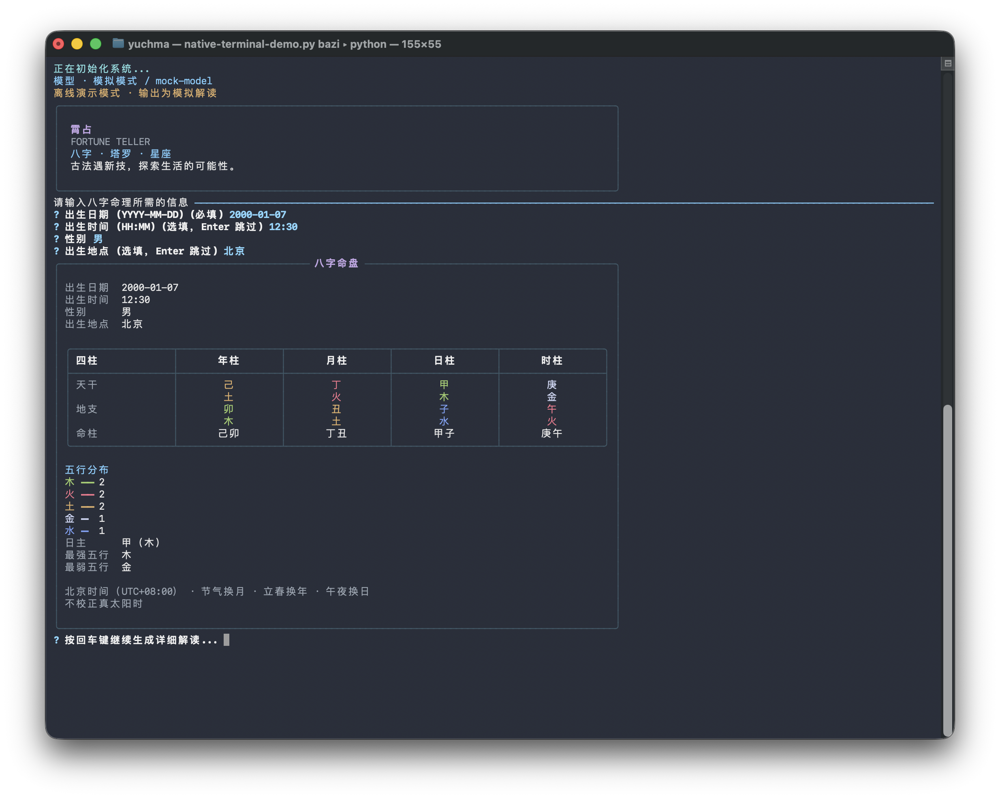
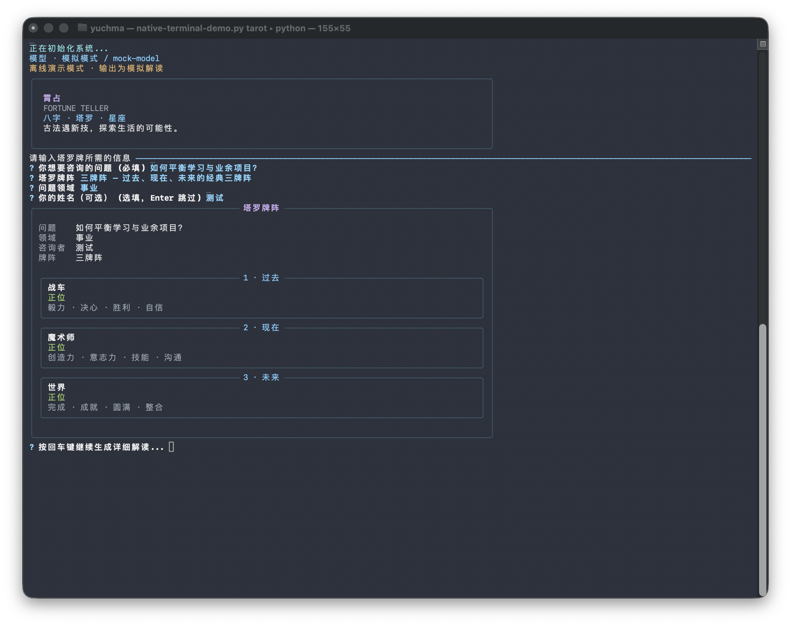
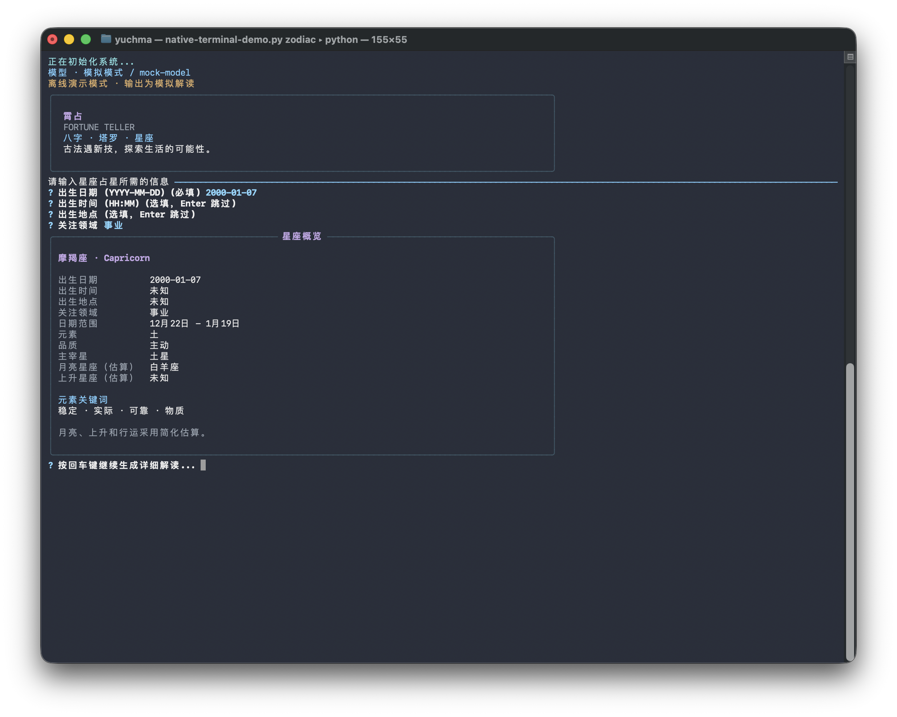

# 霄占 (Fortune Teller)

```
██╗  ██╗██╗ █████╗  ██████╗      ███████╗██╗  ██╗ █████╗ ███╗   ██╗
╚██╗██╔╝██║██╔══██╗██╔═══██╗     ╚══███╔╝██║  ██║██╔══██╗████╗  ██║
 ╚███╔╝ ██║███████║██║   ██║       ███╔╝ ███████║███████║██╔██╗ ██║
 ██╔██╗ ██║██╔══██║██║   ██║      ███╔╝  ██╔══██║██╔══██║██║╚██╗██║
██╔╝ ██╗██║██║  ██║╚██████╔╝     ███████╗██║  ██║██║  ██║██║ ╚████║
╚═╝  ╚═╝╚═╝╚═╝  ╚═╝ ╚═════╝      ╚══════╝╚═╝  ╚═╝╚═╝  ╚═╝╚═╝  ╚═══╝
```

> ✨ 古今命理，尽在掌握 ✨

**[English](README.md) | 中文**

一个终端里跑的命理占卜小工具，把传统占卜系统 + 现代大模型串在一起。Rich 命盘与 Markdown 解读、Questionary 菜单、中英双语、流式输出。

## 终端实拍

以下是新版 CLI 在 **macOS Terminal 实际运行**的截图，使用示例输入与离线 mock 配置，停在生成大模型解读之前。塔罗采用随机抽牌，每次结果可能不同。

### 八字：四柱与五行分布

输入出生日期、可选出生时间、性别和地点，查看年柱、月柱、日柱、时柱，以及按颜色区分的五行和数量分布。时间按北京时间解释，出生地点不会自动触发时区换算。



### 塔罗：问题、牌阵与卡牌

输入问题，选择牌阵与关注领域；每张卡牌展示所在位置、正逆位和关键词。截图使用「过去、现在、未来」三牌阵。



### 星座：一屏查看星座概览

输入生日与关注领域，查看太阳星座、元素、品质和主宰星。月亮、上升与行运采用简化估算，并非完整的天文星盘。



命盘展示后按 Enter 开始生成解读，之后可继续追问。Rich 负责流式 Markdown 排版，Questionary 提供菜单和输入校验。

## 🌟 功能特色

- **🀄 八字命理** — 传统四柱推命，基于出生年月日时
- **🃏 塔罗牌** — 多种牌阵，抽牌 + 解牌
- **⭐ 西方占星** — 基于生日的星座分析
- **💬 追问对话** — 解读完可以继续深挖（事业、感情、健康、流年……）
- **🌍 中英双语** — 启动选语言，或用 `--lang` 参数
- **⌨️ 方向键菜单** — 非 TTY 环境自动退化为数字输入
- **⚡ 真流式输出** — Token 从大模型直接流出，加载动画覆盖首 token 等待
- **🔌 多家 LLM** — AWS Bedrock (Claude)、Anthropic 直连、OpenAI、DeepSeek

## 🚀 快速开始

```bash
# 1. 克隆
git clone https://github.com/YuchengMaUTK/fortune-teller.git
cd fortune-teller

# 2. 装依赖
python -m venv .venv && source .venv/bin/activate
pip install '.[bedrock]'  # 也可选 openai / deepseek / anthropic / all

# 3. 配置
cp config.yaml.example config.yaml
# 编辑 config.yaml：选一个 provider，填凭证。详见下文。

# 4. 运行
python -m fortune_teller
```

**常用参数：**

```bash
python -m fortune_teller --lang zh        # 跳过语言选择
python -m fortune_teller --system bazi    # 跳过系统选择
python -m fortune_teller --list           # 列出可用占卜系统
python -m fortune_teller --verbose        # 打开控制台日志
```

## 🔧 配置说明

所有配置在 `config.yaml` 里。示例文件列出了所有 provider，选**一个** `llm:` 块即可。

### AWS Bedrock（推荐）

```yaml
llm:
  provider: aws_bedrock
  model: us.anthropic.claude-sonnet-4-5-20250929-v1:0
  region: us-west-2
  temperature: 0.7
  max_tokens: 6000
  # profile: my-profile    # 可选：~/.aws 下的命名 profile
```

凭证走 **boto3 默认解析链**：

1. `config.yaml` 里显式写的 `aws_access_key` / `aws_secret_key`
2. `profile:` 字段指向的命名 AWS profile
3. 环境变量（`AWS_ACCESS_KEY_ID` / `AWS_PROFILE` / …）
4. `~/.aws/credentials` 的 default profile、SSO、IMDS、`credential_process`……

如果 shell 里 `aws sts get-caller-identity` 能跑通，这里就能跑通。

### Anthropic 直连

```yaml
llm:
  provider: anthropic
  model: claude-sonnet-4-5-20250929
```

从 `ANTHROPIC_API_KEY` 读 key。

### OpenAI

```yaml
llm:
  provider: openai
  model: gpt-4o-mini
```

从 `OPENAI_API_KEY` 读 key。

### DeepSeek

```yaml
llm:
  provider: deepseek
  model: deepseek-chat
```

从 `DEEPSEEK_API_KEY` 读 key。

## 🎮 使用流程

1. 选语言（方向键，`q` 退出）
2. 选占卜系统
3. 按提示填信息——生日 / 时间 / 问题 / 牌阵
4. 看解读流式吐出来
5. 读完主解读之后，可以挑一个深入话题再解一次，或者直接跟霄占聊天

## 🏗️ 架构

```
fortune_teller/
├── main.py              # CLI 入口、交互菜单、追问、聊天
├── core/
│   ├── llm_connector.py # 统一 LLM 调度（Bedrock/Anthropic/OpenAI/DeepSeek）
│   ├── aws_connector.py # Bedrock 流式 + 非流式
│   ├── config_manager.py
│   ├── plugin_manager.py
│   └── mock_connector.py
├── plugins/             # 占卜系统（每个自带 prompt 和数据）
│   ├── bazi/
│   ├── tarot/
│   └── zodiac/
├── tools/
│   ├── llm_tool.py      # LLMTool 包装（读 config.yaml）
│   └── mcp_tools.py     # 对包内计算器的 subprocess 封装
├── ui/
│   ├── keyboard_input.py # 方向键菜单，TTY 自适应
│   ├── display.py        # 流式打印、头部、动画
│   └── animation.py
└── i18n/
    └── locales/         # en.json / zh.json
```

`fortune_teller/calculators/` 包含纯 Python 计算器（八字四柱、抽牌、星座判定）；`tools/mcp_tools.py` 通过 subprocess 调用包内模块。仓库根目录的 `mcp/tools/` 保留兼容命令入口。

## 🤝 贡献

见 [CONTRIBUTING.zh.md](CONTRIBUTING.zh.md) — 开发环境、代码规范、新增占卜系统/新语言的指南。

## 📄 许可证

MIT — 详见 [LICENSE](LICENSE)。

## 🙏 致谢

- 传统中国命理智慧
- Anthropic、OpenAI、AWS Bedrock、DeepSeek —— 干真正重活的大模型
- 每一位开 issue 和提 PR 的朋友

---

**古法遇新技，愿你玩得开心。** ✨

## 开发与排盘约定

需要 Python 3.10+。开发环境安装 `pip install '.[dev]'`，离线测试运行 `python -m pytest`。模型 SDK 是可选依赖；`requirements.txt` 保留完整安装方式。

八字 CLI 和插件共用 `lunar_python` 历法：按立春换年、节气换月。输入时间按北京时间（UTC+08:00）解释，日柱午夜换日（sect 2），23 点进入子时；出生地点不参与时区转换或真太阳时校正。海外出生时间请先换算为北京时间。时间未知时暂用中午排年、月、日柱，时柱显示未知，节气当日可能有歧义。

真实模型连接失败会显示错误。离线演示请显式配置 `provider: mock`，输出标记 `[MOCK]`。默认测试不调用付费服务；旧的在线诊断脚本需单独运行。计算器位于 `fortune_teller/calculators/`，`mcp/tools/` 保留旧命令兼容入口。

## 终端界面

界面使用 Rich + Questionary：八字四柱与五行表、塔罗卡牌面板、星座概览，以及带校验的输入和方向键菜单。菜单支持 ↑↓、Enter，按 q 或 Esc 返回。窄终端会调整命盘布局。

在交互终端中，模型回复逐段排成 Markdown，当前段落显示流式预览；已完成的段落保留在终端历史中。管道和重定向使用数字菜单与原始流式文本，不输出颜色或光标重绘序列。`--output reading.json` 在解读结束后保存实际内容。

无需 API 凭证即可体验三种模式：

```bash
cp config.yaml.mock demo.yaml
python -m fortune_teller --config demo.yaml --lang zh --system bazi
python -m fortune_teller --config demo.yaml --lang zh --system tarot
python -m fortune_teller --config demo.yaml --lang zh --system zodiac
```

配置文件名需以 `.yaml`、`.yml` 或 `.json` 结尾。mock 模式会明确标记，不调用大模型。连接真实模型时使用上面的 provider 配置；`max_tokens: 6000` 为长解读留出更多空间，实际所需额度取决于模型与提示词。

导出解读：`python -m fortune_teller --config config.yaml --output reading.json`。设置 `NO_COLOR=1` 可关闭颜色。
